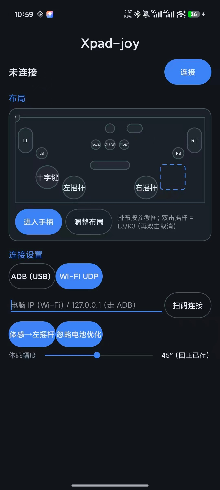
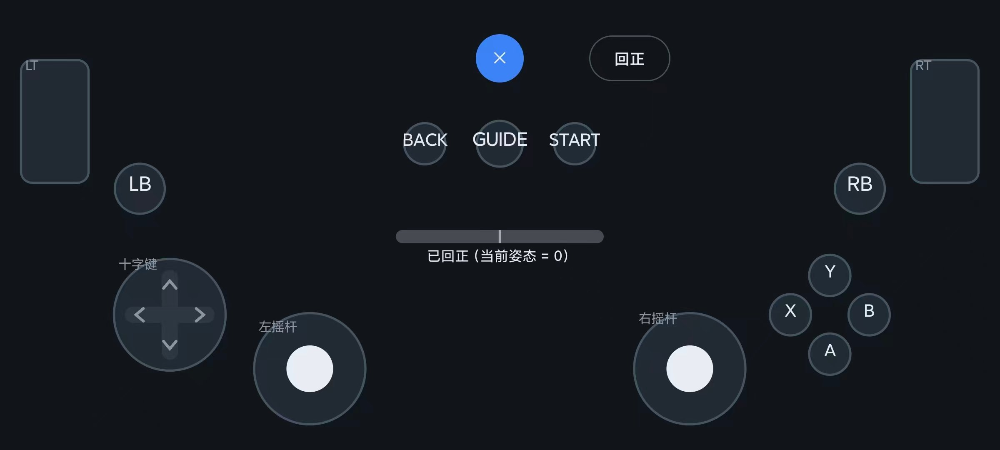
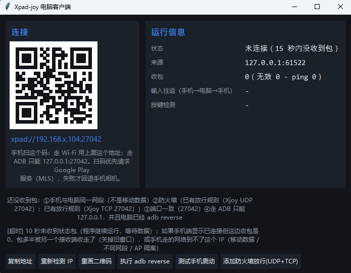

# Xpad-joy

把安卓手机变成一个电脑游戏手柄。手机 App 按 Xbox 手柄的布局排键（十字键、双摇杆、ABXY、LB/RB、LT/RT、BACK·START·GUIDE），输入实时传到电脑；电脑端脚本用 **vgamepad（ViGEmBus 驱动）** 注册一个真正的 Xbox 360 虚拟手柄，游戏直接认它，不需要额外映射工具。

- Android **8.0（API 26）及以上**
- 多点触控：一根手指只管它按下的那个区域，「摇杆 + A + RT」可以同时按
- 双击摇杆 = L3 / R3（再双击取消）
- 陀螺仪可映射到左摇杆（第一屏开关 + 幅度滑条）
- 游戏发给虚拟手柄的震动会回传给手机马达

编译好的文件在 **[Releases](https://github.com/wenjunbin8/xpad-joy/releases)**：`Xpad-joy-Installer.exe`（电脑端安装引导）和 `Xpad-joy.apk`（安卓 App，debug 构建）。

---

## 界面

手机第一屏 —— 连接状态、链路选择、当前布局的实时状态图：



手柄屏 —— 沉浸全屏，按 Xbox 布局排布：



电脑客户端（tkinter）—— 二维码 + 运行信息 + 震动测试：



布局页可以点选按键拖动移位、用滑条改大小，保存后手柄屏按同一份配置摆放（`LayoutConfig`）。

## 两条链路

| 方式 | 手机 | 电脑 | 优点 | 代价 |
|---|---|---|---|---|
| **A. ADB 隧道 + 客户端**（延迟最稳） | 连 `127.0.0.1:27042`（这条只能走 TCP，ADB 不转 UDP） | 先 `adb reverse tcp:27042 tcp:27042`，再跑 `pc-receiver/client.py` | 不受 Wi-Fi 省电影响、不掉包、不占网络；手机不用开共享 | 要插线 + 开 USB 调试 |
| **B. Wi-Fi UDP + 接收脚本** | 发 JSON 数据报 | `pc-receiver/receiver.py` | 兼容最好，可回传震动 | 要在同一个 Wi-Fi（走移动数据到不了） |

端口都是 **27042**（`Protocol.UDP_PORT`，接收端 `--port` 可改）。

---

## 快速开始

1. **装 ViGEmBus 驱动**（虚拟手柄靠它）。跑 `Xpad-joy-Installer.exe` 会自动检测并静默安装，或从 [nefarius/ViGEmBus](https://github.com/nefarius/ViGEmBus/releases) 自己装。没装驱动时 `receiver.py` 会降级成控制台模式。
2. **Python 依赖**（Windows，Python 3.10+）：
   ```bash
   pip install -r pc-receiver/requirements.txt   # vgamepad + qrcode
   ```
3. **跑电脑端**：
   ```bash
   python pc-receiver/client.py            # 带界面（二维码、运行信息、震动测试）
   python pc-receiver/receiver.py          # 纯控制台版（不要 qrcode）
   ```
4. **手机**：装 `Xpad-joy.apk`（或 `adb install`），第一屏选 ADB（USB）或 Wi-Fi UDP，填电脑 IP 或点「扫码连接」，然后进手柄屏。扫码优先请求 Google Play 服务（ML Kit），失败才退回本机相机 + zxing。
5. **编译 APK**：`cd android && ./gradlew assembleDebug`。仓库里只有 `gradlew.bat`，macOS/Linux 需要先 `gradle wrapper` 补一个 `gradlew`。

> `pc-receiver/vendor/`（adb 和 ViGEmBus 安装包）是第三方二进制，不在仓库里；代码找不到时会退回 PATH 里的 adb 或 `D:\Android\SDK\platform-tools\adb.exe`。

---

## 按键与协议

按钮位（`buttons` 字段，HID 前 2 字节）：`0=A 1=B 2=X 3=Y 4=LB 5=RB 6=BACK 7=START 8=GUIDE 9=L3 10=R3`；十字键 `hat`：`0=上 1=右上 … 7=左上 8=中立`；摇杆 `-128..127`，扳机 `0..255`。`ly/ry` 向下为正，和 XInput 一致，接收端不要取反。

线上格式：一个数据报一条 JSON（TCP 上是 2 字节大端长度 + 原始包，内容一样）。

```json
{"t":"state","buttons":0,"hat":8,"lx":0,"ly":0,"rx":0,"ry":0,"lt":0,"rt":0,"rtt":12}   // 手机 → 电脑
{"t":"ping","ts":123}   /   {"t":"pong","ts":123}                                      // 测延迟
{"t":"rumble","left":255,"right":128}                                                  // 电脑 → 手机，马达反馈
```

---

## 目录

```
android/        安卓 App（Kotlin，无第三方 UI 库；自定义 View 画按键、摇杆、十字键）
pc-receiver/    电脑端：client.py（界面）、receiver.py（控制台）、installer.py / uninstaller.py、*.spec、bat、icon.ico
docs/           界面截图和归档的开发记录
tools/          生成图标的脚本（make_icon.py、preview_on_bg.py，要 Pillow）
assets/         图标主图和小尺寸预览
```

---

## 常见问题

- **手机显示已连接、电脑收包 0**：多半是不同网段（走移动数据就到不了）、防火墙，或端口被另一个接收程序占用（这个端口只能有一个程序在用）。
- **游戏里看不到手柄**：ViGEmBus 驱动没装，`receiver.py` 会降级成控制台模式；看设备管理器里有没有 ViGEmBus 设备。
- **走 ADB 时**：`currentTarget()` 一律用 `127.0.0.1`，输入框里的 IP 只给 Wi-Fi 用。客户端重启后手机每 4 秒自动重连；手动点过「断开」会关掉自动重连。
- **震动测不出真值**：`register_notification` 只在游戏真的对 XInput 设备发震动时才被调用；客户端的「测试手机震动」按钮测的是「能不能送到手机 + 手机会不会震」。

---

## 许可证

[MIT](LICENSE)。逐条改动和实测记录见 [docs/开发记录.md](docs/开发记录.md)。
