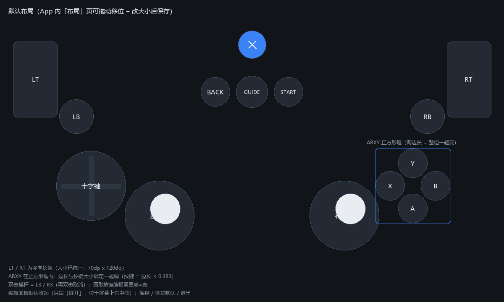

# Xpad-joy：安卓手机 → 电脑游戏手柄（界面模板参考 Xbox 手柄）

手机装一个 App（应用名 **Xpad-joy**，第一屏标题也是 Xpad-joy，桌面图标同名），按 Xbox 手柄的布局（十字键 / 双摇杆 / ABXY / LB·RB / LT·RT / BACK·START·GUIDE）操作，
把输入实时传到电脑。扫码连接这一版重新做回来了，但**解码优先请求 Google Play 服务代为扫**（ML Kit MLS，跑在 `com.google.android.gms` 里），请求失败才退回手机本机相机 + zxing 自己解；蓝牙已删掉。现在两条路：

| 方式 | 手机 | 电脑 | 优点 | 代价 |
|---|---|---|---|---|
| **A. ADB 隧道 + 客户端**（延迟最稳） | 电脑跑 `adb reverse tcp:27042 tcp:27042`，手机连 `127.0.0.1:27042`（这条只能走 TCP，ADB 不转 UDP） | `pc-receiver/client.py` 用 vgamepad（ViGEmBus）生成真正的 Xbox 360 虚拟手柄 | 不受 Wi-Fi 省电影响、不掉包、不占用网络；手机不用开共享 | 要插线 + 开 USB 调试，电脑要跑客户端 |
| **B. Wi-Fi UDP + 接收脚本** | 发 JSON 数据报 | `pc-receiver/receiver.py` 用 vgamepad（ViGEmBus）生成一个真正的 Xbox 360 虚拟手柄 | 兼容最好（游戏直接看到一个 Xbox 手柄），可回传震动 | 电脑要跑脚本，需装 ViGEmBus 驱动 |

> Android 版本要求：**8.0（API 26）及以上**（`VibrationEffect`、`SensorManager` 体感、`ConnectivityManager` 网络诊断都从这里开始）；本机按 API 36 编译。蓝牙模式已删掉。

---

## 一、界面布局（对照 Xbox 手柄）



> 示意图是工程示意（L3/R3 在摇杆圆内：双击摇杆触发）。实际 App 分两屏：第一屏是连接状态和**当前布局的状态图**（运行信息显示在电脑端程序），第二屏是按键面板，排布按参考图（左列 LT→LB→十字键→左摇杆；右列 RT→RB→ABXY→右摇杆；中列 ✕ + BACK·GUIDE·START），按钮形状与功能不变。


```
左列                            中列                       右列
LT 竖向长条              ✕ 回第一屏                  RT 竖向长条
（贴左边缘）          BACK · GUIDE · START           （贴右边缘）
  ● LB（LT 右下）           （下面留空）         RB ●（RT 左下）
● 十字键（圆形）            连接信息在             ABXY 菱形（收紧）
        第一屏              ● 左摇杆（内移）    右摇杆（内移） ●
        双击左摇杆 = L3 / 双击右摇杆 = R3（再双击取消）
```

默认值写在 `LayoutConfig.resetDefaults()`（归一化中心坐标 + dp 尺寸），App 内「布局」页可以点选按键拖动移位、用滑条改大小（圆形按键高=宽），保存后手柄屏按同一份配置摆放。LT / RT 还能转角度（布局页的「旋转」滑条，90° 整倍数吸附），见第 21 条。

布局页的弹窗默认收起 = 屏幕上方中间**只有「展开」一个按钮**（没有卡片外框）；展开后是 边长 或 宽/高 滑条 + 保存 / 恢复默认 / 退出，再点「收起」缩回只剩按钮。手柄屏和布局页都是**沉浸全屏**：状态栏与导航栏隐藏，刘海/挖孔区域也照用（`Immersive.kt` 用 `CUTOUT_MODE_ALWAYS`，手柄屏根布局不再 `fitsSystemWindows`），所以左侧不会空出一条；第一屏 Home 保留状态栏并**保留刘海区域**（`fitsSystemWindows="true"`），文字不会被挖孔切到。

第一屏「布局」卡片里的图不是固定图片，而是 `LayoutPreviewView` 按当前 `LayoutConfig` 实时绘制的状态图（保存新布局后回第一屏就会重画）。运行信息（按键、十字键、摇杆、扳机、收包数、震动）已从第一屏删掉，改由电脑端 `receiver.py` 打印。

ABXY 按**正方形框**模型调整：框有中心位置和边长，框内按键大小 = 边长 × `ratio`（默认 120dp × 0.383 ≈ 46dp），两者**锁定一起变**——滑条只调边长，整组（四个键 + 间距）等比缩放，按键始终在框内不会互相挤。四个键的相对位置固定在 ±0.30 边长处（上 Y、下 A、左 X、右 B）。想再加一个整组，在 `LayoutConfig.resetDefaults()` 里加一个 `Group(...)` 和几个带 `rx` / `ry` 的 `addGrouped()` 槽即可。

| 区域 | 控件类 | 行为 | 协议字段 |
|---|---|---|---|
| 1 模拟扳机 LT/RT | `TriggerView` | 竖向长条（贴左右边缘）；按得越深值越大（0–255，轻点至少 50% 行程） | `lt` / `rt` |
| 2 肩键 LB/RB | `GameButtonView` | 圆形；LB 在 LT 右下、RB 在 RT 左下；数字按键 | bit4 / bit5 |
| 3 左右摇杆 | `StickView` | 拖动方向，抬手归中，带 12% 死区；**按下不染色**（白色旋钮）。帽中心最远 = 半径 − 帽半径，所以推到边缘不会顶出描边、不会盖住标签。**双击摇杆 = L3 / R3**（再双击取消；锁定时摇杆帽画蓝色小环 + 左下角写 L3/R3），单独的小按钮已取消，减少误触 | `lx,ly,rx,ry`（-128..127）+ bit9 / bit10 |
| 4 十字键 | `DpadView` | 8 方向（HID hat）；圆形底盘 + 十字臂 + 四方向 chevron | `hat` |
| 5 ABXY | `GameButtonView` | 数字按键；菱形排布且收紧（Y 上 A 下 X 左 B 右） | bit0..bit3 |
| 6 中心键 | `GameButtonView` | GUIDE(Xbox logo)、BACK、START | bit8, bit6, bit7 |
| 7 第一屏 (Home) | `HomeActivity` | 连接状态、连接/断开、链路选择（ADB（USB） / Wi-Fi）、手输电脑 IP + 「扫码连接」入口、当前布局的状态图（`LayoutPreviewView`）、体感开关；运行信息在电脑端客户端 | — |

多点触控：一根手指只控制它按下的那个区域，所以「摇杆 + A + RT」可以同时操作（真手柄式的操作方式）。

---

## 二、协议（安卓端与电脑端必须一致）

### 按钮位（bit 序号，`buttons` 字段 / HID 前 2 字节）

| bit | 按键 | bit | 按键 |
|---|---|---|---|
| 0 | A | 6 | BACK（Select） |
| 1 | B | 7 | START |
| 2 | X | 8 | GUIDE（Xbox 圆形 logo） |
| 3 | Y | 9 | L3（左摇杆按下） |
| 4 | LB | 10 | R3（右摇杆按下） |
| 5 | RB | | |

### 十字键 `hat`（HID hat switch 取值）

`0=上 1=右上 2=右 3=右下 4=下 5=左下 6=左 7=左上 8=中立`

### HID 输入报告（Report ID 1，正文 9 字节）

```
[0] 按钮 bit0..bit7      [1] 按钮 bit8..bit10（+5 bit padding）
[2] hat（4 bit + 4 bit padding）
[3] LX  [4] LY  [5] RX  [6] RY      （有符号 -128..127，中心 0）
[7] LT（0..255）  [8] RT（0..255）
```

输出报告（Report ID 2，2 字节，电脑 → 手机，用于震动）：`[0]=左马达 [1]=右马达`。
完整 Report Descriptor 见 `android/.../Protocol.kt`（蓝牙删掉后，它只作为字段定义和 9 字节报告的参考；UDP 走 JSON）。

### Wi-Fi 模式的线上 JSON（一个数据报一条）

手机 → 电脑：
```json
{"t":"state","buttons":0,"hat":8,"lx":0,"ly":0,"rx":0,"ry":0,"lt":0,"rt":0,"rtt":12}
```
`rtt`、`ts`、`srtt` 都是**可选**字段（`rtt` = 上一次 ping→pong 往返；`ts` = 发包时刻，用来测输入路径；`srtt` = 手机算出的输入路径往返）。没测到就不带；接收端遇到未知字段会忽略，所以老版本仍然兼容。

手机 → 电脑（每 1 秒一次，用来测延迟）：
```json
{"t":"ping","ts":<手机 elapsedRealtime 毫秒>}
```
电脑 → 手机（原样回传 `ts`，手机据此算 RTT 并在下一个 state 包里带回来）：
```json
{"t":"pong","ts":<同一个值>}
```
电脑 → 手机（震动回传，手机会马达反馈）：
```json
{"t":"rumble","left":255,"right":128}
```
端口：**27042**（`Protocol.UDP_PORT`，接收端 `--port` 可改）—— Wi-Fi 走 UDP，走 ADB 走 TCP，包内容完全一样。

### 地址怎么来：扫码（优先 Google Play 服务）或手输

手机第一屏那个地址框（`pc_ip` / `pc_port`）有两个来源：点「扫码连接」进扫码页，或者手输这两条之一，点「连接」：

```
Wi-Fi：192.168.x.104:27042  → UDP
USB（ADB）：127.0.0.1:27042   → TCP（电脑先 adb reverse tcp:27042 tcp:27042）
```

二维码内容是 `xpad://<电脑IP>:<端口>`（电脑客户端画的就是这个，`Protocol.QR_SCHEME`）。扫码页的分工是：**相机只负责取帧，解码先请求 Google Play 服务**（`PlayScanner` = ML Kit MLS，模型和推理都在 `com.google.android.gms` 进程里）；请求失败（这台机器没装 Play 服务 / 版本太旧 / MLS 模块没下载 / 处理这帧出错）才退回**本机相机 + zxing**（`QrScanner`）。所以相机权限两条都要用，"原相机"指的是回退到 zxing 自己解。页面上会写当前用哪一条、Play 和相机各解了多少帧、失败原因；还有「只用相机（zxing）」可以手动指定。扫到的内容存进 prefs `qr_last`，第一屏状态行会写「扫码记录」。

走 ADB 时扫来的 IP 用不上：`adb reverse` 只把电脑端口转发到手机的 `127.0.0.1`，所以这条只能连 127.0.0.1，扫来的地址只当 Wi-Fi 那条的候选。ADB 只转 TCP，所以这条是 TCP；TCP 上每条消息 = 2 字节大端长度 + 原始包，包内容跟 UDP 那条一模一样。

> 注意：`ly/ry` 是「向下为正」，与 XInput 的 `left_y/right_y` 方向一致，接收端不要取反。

---

## 三、安卓端

```
android/
├── build.gradle / settings.gradle / gradle.properties
└── app/
    ├── build.gradle                        (minSdk 26, targetSdk 36, Kotlin；只有扫码那两个依赖：MLS 接口 + zxing)
    └── src/main/
        ├── AndroidManifest.xml             (INTERNET + ACCESS_NETWORK_STATE + VIBRATE + ACCESS_WIFI_STATE + CAMERA（扫码页取帧）；Home 竖屏，Gamepad 横屏，QrScan 竖屏)
        ├── res/
        │   ├── layout/activity_home.xml    (第一屏：连接状态 + 当前布局状态图，保留刘海；地址框右边多一个「扫码连接」按钮)
        │   ├── layout/activity_gamepad.xml (第二屏：按键面板，按 LayoutConfig 摆放)
        │   ├── layout/activity_editor.xml  (布局页：可收起弹窗，只留「展开」)
        │   ├── layout/activity_qr.xml      (扫码页：每帧自己画灰度预览（不靠硬件加速）+ 解码 Play 优先、zxing 回退；扫到默认自动连并回第一屏)
        │   └── drawable/pill_primary.xml、pill_outline.xml、card.xml
        └── java/com/xpad/joy/
            ├── Protocol.kt      字段定义 + HID Report Descriptor
            ├── GamepadState.kt  状态、HID 报告编码、JSON 编码、20 字节紧凑包编码
            ├── Transport.kt     传输抽象
            ├── PlayScanner.kt    扫码主路径：请求 Google Play 服务代为解码（ML Kit MLS，推理在 com.google.android.gms 里跑）
            ├── QrScanner.kt      回退：本机相机帧 + zxing（只吃 YUV 的 Y 平面，TRY_HARDER）
            ├── QrScanActivity.kt 扫码页：Camera2 取帧、每帧自己转彩色小图（YUV→RGB）贴到 ImageView、扫到自动连并回第一屏、闪光灯开关
            ├── ScanPreviewView.kt 扫码页画面 + 四角括号（自己画，双线性滤波；硬件加速关着时 ImageView 放大不滤波就是马赛克）
            ├── GamepadActivity.kt  第二屏按键面板（体感：相对旋转取绕世界竖直方向的分量 + 进度条 + 回正按钮）
            ├── GyroBarView.kt      体感进度条（中心刻度 + 往左/右填 + 显示度数；只显示）
            ├── UdpTransport.kt  Wi-Fi 那条：UDP（独立发送线程 + 只留最新一帧；震动回传、每秒 ping）
            ├── Views.kt         按键 / 摇杆 / 十字键 / 扳机 自定义 View（扳机可旋转：绘制绕中心转、触摸点反旋转）
            ├── LayoutConfig.kt  按键槽（归一化位置 + dp 尺寸 + LT/RT 角度）+ 保存/恢复默认
            ├── PadContainer.kt  按 LayoutConfig 摆放按键的容器（手柄屏根布局）
            ├── EditorView.kt    布局编辑器画布（点选 + 拖动 + LT/RT 旋转滑条）
            ├── LayoutPreviewView.kt 第一屏卡片里的当前布局状态图（实时绘制）
            ├── Immersive.kt     沉浸全屏（隐藏状态栏/导航栏，刘海用 CUTOUT_MODE_ALWAYS）
            ├── LayoutActivity.kt 布局页：可收起弹窗 + 滑条改大小 + 保存/恢复默认/退出
            ├── Controller.kt    跨屏共享的状态与连接（Home 与 Gamepad 用同一份）
            ├── HomeActivity.kt  第一屏：状态、模式、IP、扫码入口、权限、布局状态图 + 体感幅度滑块
            ├── BaseTransport.kt 两条路共用的部分：拼包 + 只留最新一帧 + 每秒 ping + 解析 XACK/JSON 回复
            ├── TcpTransport.kt  USB 那条：ADB 隧道（TCP，2 字节大端长度 + 原始包；包内容跟 UDP 那条完全一样）
            └── GamepadActivity.kt 第二屏：按键绑定与状态行
```

### 已在本机编译通过（Android 16 / API 36）

```powershell
$env:JAVA_HOME = "D:\Android studio\jbr"
& "D:\project\PadLink\tools\gradle\gradle-8.13\bin\gradle.bat" -p "D:\project\实训\xpad-joy\android" clean assembleDebug
```
产物：`android/app/build/outputs/apk/debug/app-debug.apk`（**4275 KB**（2026-11-25 22:10，含第 42 条的断开修复；上一次是 4185 KB），minSdk 26 / targetSdk 36；扫码那两条依赖是新增的：zxing core 610 KB + Google Play 服务接口层约 1.5 MB（`play-services-mlkit-barcode-scanning` 519 KB、`play-services-base` 440 KB、`play-services-basement` 286 KB、`vision-common` 269 KB、`play-services-tasks` 80 KB），debug 没开混淆。模型本身不占 APK —— MLS 的模型和推理在 Google Play 服务里）。

两个必要的构建说明：
1. **路径含中文**（`D:\project\实训`）会被 AGP 直接判定失败，所以 `gradle.properties` 里加了 `android.overridePathCheck=true`。要彻底避免，可把工程复制到纯 ASCII 路径。
2. **不再依赖 appcompat**（用 `Activity` + `Theme.DeviceDefault`），APK 从 3.4 MB 降到 842 KB。

蓝牙模式已删掉：`HidTransport.kt` 已移除，`AndroidManifest.xml` 里不再有蓝牙权限（相机权限这一版加回来，只给扫码页取帧）。`Transport` 现在两个实现：`UdpTransport`（Wi-Fi）和 `TcpTransport`（USB 走 adb 隧道），拼包、队列、ping、解析回复这些共同部分在 `BaseTransport`。

安装到手机（本机 `adb` 在 `D:\Android\SDK\platform-tools\adb.exe`，当前没有连接设备）：

```powershell
D:\Android\SDK\platform-tools\adb.exe install -r "D:\project\实训\xpad-joy\android\app\build\outputs\apk\debug\app-debug.apk"
```

运行步骤：
1. Android Studio → `Open` → 选 `android/` 目录，等 Gradle 同步。
2. 手机开发者模式 + USB 调试，`Run` 安装（或 `gradle assembleDebug` 出 APK）。
3. 打开 App → 第一屏（竖屏）选模式、填电脑 IP（走 ADB 就填 127.0.0.1）、点「连接」，再点「进入手柄」（横屏）操作按键。连接在第一屏建立，切屏不会断开。想改按键大小或位置：第一屏点「调整布局」（或导航「布局」），点选一个按键后拖动移位、用滑条改大小（ABXY 是正方形框：只调边长，四个键和间距一起等比缩放），点「保存」后手柄屏按新布局摆放；「恢复默认」回到出厂布局。布局里还有一条「体感条」槽（进度条），也能拖动改大小。第一屏卡片里的状态图会按当前布局重画（按手柄横屏比例等比缩放）；运行信息和连接延迟在电脑端客户端 `pc-receiver/client.py` 显示。

**USB 走 ADB（延迟最稳，推荐）：**
- 手机插上 USB 线并开 USB 调试（开发者选项 → USB 调试）。App 自己不能当 adb 客户端，所以隧道要在电脑上建一次：`adb reverse tcp:27042 tcp:27042`（客户端窗口的「执行 adb reverse」按钮就是干这个的：先找 PATH 里的 adb，找不到再试 `D:\Android\SDK\platform-tools\adb.exe`）。`
- App 第一屏选「ADB（USB）」→ 地址填 `127.0.0.1` →「连接」。这条只能走 TCP（ADB 不转 UDP）：流里每条消息 = 2 字节大端长度 + 原始包，包内容跟 Wi-Fi 那条完全一样；电脑的回包（XACK / pong / 震动）也按同样的帧写回。Wi-Fi 那条照旧走 UDP，两条可以同时用。
- 验证：Windows 运行 `joy.cpl`，应看到一个游戏控制器，按键/摇杆/扳机都能响应。

**Wi-Fi 模式：**
- 手机和电脑连同一个 Wi-Fi（或同一网段）。
- 底部选「Wi-Fi UDP」→ 填电脑 IP →「连接」。

---

## 四、电脑端（Wi-Fi 模式）

### 独立客户端（窗口：地址 + 运行信息 + 虚拟手柄）

最省事的启动方式：双击 `pc-receiver/启动客户端.bat`（会自动找 `py` / `python`，**不装任何东西**；缺 `vgamepad` 只是不创建虚拟手柄，运行信息照常显示）。这个 bat 里不能写中文：cmd.exe 读 UTF-8 的 bat 会把中文行解析错（实测报 `'里只检查' is not recognized as an internal or external command`、`The system cannot find the drive specified.`），中文被当成命令执行，`%PY% client.py` 那行就被吞掉 —— 于是只有黑窗口、客户端窗口打不开。现在 bat 是纯 ASCII，中文提示都放在 `client.py` 里。要看软件路径的延迟下限，跑 `python pc-receiver/tools_latency_check.py`（解析耗时 + 本机回环 UDP 往返）；要看体感为什么横屏不灵敏，跑 `python pc-receiver/tools_gyro_axis_check.py`。

```bash
pip install vgamepad                 # ViGEmBus 驱动你已经装好，程序不会去重装；qrcode 只用来画窗口里那个二维码（这台机器没有 PIL，代码只用模块矩阵画到 tkinter Canvas，不调 make_image）
python pc-receiver/client.py       # 默认端口 27042：UDP 和 TCP 都监听（TCP 是 ADB 隧道那条）
python pc-receiver/client.py --ip 192.168.1.10 --port 27042
python pc-receiver/client.py --console    # 只看运行信息，不创建虚拟手柄（--no-tcp 只留 UDP，但那样 ADB 那条就走不了）
```

窗口内容（这一版按你给的参考图简化成两块卡片 + 两行）：
- **左边卡片「连接」**：二维码（内容是 `xpad://<本机IP>:<端口>`，只用 `qrcode` 的模块矩阵画到 tkinter Canvas，**不依赖 PIL**；`--qr-bg` / `--qr-ink` 改颜色，`--no-qr` 关掉）+ 地址 + 一行说明（走 Wi-Fi 用这个地址；走 ADB 只能 `127.0.0.1:<端口>`；扫码优先请求 Google Play 服务（MLS），失败才回退手机相机）；
- **右边卡片「运行信息」**：只留 5 行 —— 状态、来源、收包、输入往返（手机→电脑→手机）、按键检测（按下时写按键名；没按键但动了十字键/摇杆/扳机就写 `十字键=3 左(100,-50) LT 50%`）。监听、收包路径、速率、延迟 RTT、单程估算、包间隔、电脑处理、震动、包格式、模式这些按你的要求不再显示（要看就看下面那行事件和 `adb logcat`）；
- **下面两行**：没收到包时的自检（同一网段 / 防火墙 / 端口 / `adb reverse`）+ 最近一条事件（自检、首包、adb、复制地址、刷新出错）；
- 「状态」按**电脑真的收到过包**写：15 秒内有包 = `已连接（最近 X 秒前，走 …）`，否则 `未连接`；
- 按钮：复制地址 / 重新检测 IP / 重画二维码 / 执行 adb reverse（启动时自动跑一次，之后每 30 秒补一次）/ 测试手机震动 / 防火墙放行；
- 窗口模式下这些信息只显示在窗口里（命令行不再重复输出一份）；`--console` 模式才往命令行打印。

延迟为什么低：收包和写 ViGEmBus 在同一个后台线程里完成，UI 每 200ms 只读一次快照，不在数据路径上；手机每 2 秒发一次 `ping`，客户端回 `pong`，手机算出真实往返延迟并在 state 包的 `rtt` 字段带回来。本机实测（console 模式）：

```
[运行信息] buttons=6 [B,X] hat=4 sticks=(-100,30,0,0) triggers=(0,128)
           来源=127.0.0.1:51464  收包=1  无效=0  震动=0  模式=控制台
           延迟 RTT=7ms  收包速率=0.0/s  包间隔 avg=0ms max=0ms  ping=1
```

不想开窗口的话用 `python pc-receiver/receiver.py`（同一套协议，纯控制台，运行信息每 `--status-interval` 秒打印一次）。

- 装好 ViGEmBus 后，客户端会创建一个真正的 Xbox 360 虚拟手柄（XInput），游戏直接可玩；没驱动时自动降级为控制台模式。
- 现在只有 vgamepad 这一条路，生成的就是 XInput 设备（Xbox 360 虚拟手柄），不需要 x360ce / InputMapper。

**已经打包成 exe（源代码保留，两种都能跑）**：

- exe：`pc-receiver/Xpad-joy.exe`（单文件、**windowed：只有 GUI 窗口，没有黑窗口**，**12407 KB**，本机 Python 3.14.3 + pyinstaller 6.22.3）。构建脚本 `pc-receiver/打包exe.bat`（它不自己 pip install，要先 `pip install pyinstaller`），产物 `dist\Xpad-joy.exe`，bat 会把它复制到自己旁边。
- 构建命令（和 bat 里一致）：

  ```bash
  py -3 -m PyInstaller --onefile --windowed --name Xpad-joy --clean client.py
  ```

- 没有控制台，所以 `client.py` 的 `say()` 把消息写到 exe 旁边的 **`Xpad-joy.log`**（windowed 版的出错信息只能从这里看）；`receiver.py` 的 `p()` 加了 `sys.stdout is None` 保护 —— windowed 版没有 stdout，直接 `write` 会抛异常。
- `启动客户端.bat` 先看同目录有没有 `Xpad-joy.exe`：有就跑 exe（这台机器上不需要 Python、不会 pip 装任何东西），没有才回退 `py -3 client.py`。`client.py` / `receiver.py` 原样保留。
- 实测：双击 exe 只出现窗口，标题 `Xpad-joy 电脑客户端` ✓；`Xpad-joy.log` 里能看到 `[监听] UDP + TCP …`、`[首包]` 和运行信息，手机走 Wi-Fi UDP 连上（来源 `192.168.x.41`，输入路径往返 6 ms）✓。`--help` 在 windowed 版里不打印（没有控制台），要看参数就跑源代码版。exe 里带 qrcode（画得出二维码）；vgamepad 仍依赖系统里已装的 ViGEmBus 驱动，驱动没装会自动降级为控制台模式。
- **不再闪黑窗口**：windowed 版本身没有控制台，但 Windows 会给它启动的控制路子进程（`netsh` 防火墙、`adb`、`powershell` 网卡省电）另分配一个控制台窗口，所以双击 exe 会先闪几个黑窗口才出界面。`client.py` 里 4 处 `subprocess` 调用都加了 `creationflags=NO_WINDOW`（`0x08000000`，非 Windows 时是 0）→ 不闪了，输出仍然靠 `capture_output` 拿回来。另外 `note()` 现在也会把每条消息写进日志（界面上只显示最近 8 条），所以 `[adb] …`、`[网卡省电] …`、`[二维码] 已画在窗口上…` 这些以前只在窗口里出现的行，在 `Xpad-joy.log` 里也留下了：
  ```
  [adb] adb 返回码 1：adb.exe: no devices/emulators found
  [网卡省电] 没有活动的无线网卡（走 ADB 隧道/有线，这条跳过）…
  [二维码] 已画在窗口上（xpad://192.168.x.104:27042）…
  ```
  注意：双击 **bat** 还会有一个 cmd 窗口（那是 bat 自己的，不是 exe 的）；要完全没窗口就直接双击 `Xpad-joy.exe`。

### 安装引导 exe（`pc-receiver/Xpad-joy-Installer.exe`，43486 KB）

- 源码 `pc-receiver/installer.py`，构建脚本 `pc-receiver/打包安装引导.bat`（纯 ASCII，不 pip install：要先 `pip install pyinstaller`，并且先跑 `打包exe.bat` 生成 `Xpad-joy.exe`）。打包：

  ```bash
  py -3 -m PyInstaller --onefile --windowed --name Xpad-joy-Installer --clean ^
      --add-data "Xpad-joy.exe;." --add-data "Xpad-joy-Uninstaller.exe;." ^
      --add-data "vendor\ViGEmBus_1.22.0_x64_x86_arm64.exe;." ^
      --add-data "vendor\platform-tools;platform-tools" installer.py
  ```

- 界面（中文、windowed，子进程也加了 `CREATE_NO_WINDOW`，所以不闪黑窗）只有六块：顶上驱动状态、一行安装位置（默认 `%LOCALAPPDATA%\Xpad-joy`，可 浏览… 改）、两个勾选项（**桌面快捷方式**、**adb（走 USB 那条要用）：复制到安装位置 + 检测手机驱动**）、一行加粗状态（`就绪` → `安装中…` → **`安装完成 ✓`**（绿）；失败写红色原因）、两个按钮（**安装** / **退出**）、下面的日志区。点安装做五件事：把 `Xpad-joy.exe` 复制到安装位置（+ `安装说明.txt` + `安装信息.txt` + **卸载程序 `Xpad-joy-Uninstaller.exe`，放在安装目录里**）并登记 `HKCU\...\Uninstall\Xpad-joy` → 勾了才建桌面 `Xpad-joy.lnk`（PowerShell 的 `WScript.Shell` COM）→ 勾了 adb 那条就跑 adb 那段（见下）→ 检测不到驱动时**静默跑内置的驱动安装程序**。安装跑在一条线程上、日志走队列（`pump`）由主线程写界面，所以驱动装到一半界面不会卡住；跑完状态行变绿、按钮恢复成「安装」。
- **adb 那段（走 USB/ADB 隧道那条要，走 Wi-Fi 不用）**：① PATH 里有 adb 就不复制；没有就把打包进去的 `adb.exe` + `AdbWinApi.dll` + `AdbWinUsbApi.dll` 复制到安装位置（`vendor\platform-tools\`，6.7 MB），客户端的 `find_adb()` 现在会按 PATH → 自己同目录 → `D:\Android\SDK\platform-tools\adb.exe` 找，所以安装位置里这份直接能用；② 跑 `adb devices` 看驱动：有设备就是驱动好的；`unauthorized` 就是要在手机上点“允许 USB 调试”；`offline` 就跑一次 `adb kill-server` 再看；③ 没设备时用 `Get-PnpDevice -PresentOnly` 看现在插着的 Android/ADB 设备和有问题码的设备（只读、不弹窗），再 `adb kill-server` 重试一次，然后把排查顺序写在日志里（换数据线、开 USB 调试、Windows 10/11 一般自动装 WinUSB、厂商驱动、设备管理器里选 Android ADB Interface、官方 Google USB driver）。本机实测（没插线）：`adb devices（退出码 0）：没设备` → `现在没插着 Android/ADB 设备（插上线、手机开 USB 调试再看）` → `插着的设备里没有问题设备（驱动都正常）` ✓；`--check` 里也能看到 adb 来源（打包版实测显示内置的 `_MEI.../platform-tools/adb.exe` ✓）。装 adb 本身不需要联网、不 pip；真缺驱动没法自动化（要厂商 inf），所以那段是“检测 + 说清楚怎么修”。
- 驱动检测两条：注册表 `HKLM\SYSTEM\CurrentControlSet\Services\ViGEmBus`（`Start`、`ImagePath`）+ `sc query`（运行状态）。本机实测：`installed=True state=运行中 start=系统 imagepath=\SystemRoot\System32\drivers\ViGEmBus.sys driverfile=C:\WINDOWS\System32\drivers\ViGEmBus.sys` ✓。
- 驱动安装程序是官方 [nefarius/ViGEmBus](https://github.com/nefarius/ViGEmBus) v1.22.0 的 `ViGEmBus_1.22.0_x64_x86_arm64.exe`（6,278,576 字节，SHA256 `89220A7865076B342892F98865F3499FB7C4CFD673159E89D352C360FD014C6A`），存在 `pc-receiver\vendor\` 并打进引导 exe（所以引导 43487 KB ≈ 客户端 12407 KB + 驱动包 6131 KB + adb 那三个 6862 KB + Python 运行时）。它不是 Inno（文件里没有 Inno/NSIS 标记，字符串里有 `ADVINSTSFX`/`WiX`，是 Advanced Installer 的自解压包），所以命令行开关先试 `/silent` 再试 `/quiet`，每次跑完都重新检测一次；两次都没装上就提示用管理员双击驱动包走图形界面。这一条在本机验证不了（驱动已经装了，要验证就得先卸载）。
- 权限：不强制管理员（没有 `--uac-admin`），只有「静默安装驱动」那一步需要管理员 —— 非管理员时用 `Start-Process -Verb RunAs -Wait` 弹一次 UAC。复制文件和建快捷方式普通用户就能做。
- `py -3 installer.py --check`（或 `Xpad-joy-Installer.exe --check`）只检测驱动不开窗，给脚本用；打包版没有控制台，所以结果写进 `Xpad-joy-Installer.log`（界面里每条消息也同时写这个日志）。实测 `--check` 输出就是上面那行 ✓；界面路径用 `root.withdraw()` + `mainloop()` 无窗验证过：按钮按下 → 复制文件 → 写说明 → 建快捷方式 → 驱动已装就跳过 → 按钮恢复「安装」✓。

### 卸载程序（12200 KB，装完就在安装目录里）

- 安装引导会把 `Xpad-joy-Uninstaller.exe` 复制到安装目录（和 `Xpad-joy.exe`、`安装说明.txt` 放一起），所以用户在**安装位置**里双击它卸载；`pc-receiver\` 里那份只是重新打包用的源。

- 源码 `pc-receiver/uninstaller.py`，构建脚本 `pc-receiver/打包卸载程序.bat`（纯 ASCII，不 pip install）。界面同样是 windowed、不闪黑窗：驱动状态、安装位置（自动认，没有输入框也没有浏览按钮）、一个勾选项（**卸载 ViGEmBus 驱动（要管理员，默认不卸；卸了要重装才能用虚拟手柄）**）、一行加粗状态、两个按钮（**卸载** / **退出**）、日志区。
- 只删我们自己放进去的东西：`Xpad-joy.exe`、`安装说明.txt`、`安装信息.txt`、`Xpad-joy.log`、`Xpad-joy-Uninstaller.log`，加上安装引导复制过去的 `adb.exe` / `AdbWinApi.dll` / `AdbWinUsbApi.dll`（没装过就没有，日志里写“没有”，不会报错）。删 adb 之前先跑一次 `adb kill-server`（adb 服务进程会占着 `adb.exe` 删不掉），主窗口和临时副本都会跑。注意：Windows 侧的 ADB USB 驱动不在安装目录（在 `C:\Windows\System32\DriverStore`），所以没东西可删——安装目录里只有这三个文件；要卸设备侧驱动只能走设备管理器。实测：目录里有 adb 那三个 + 一个别的文件 → adb 三个删掉、别的文件保留、卸载程序自己也被删 ✓。桌面 `Xpad-joy.lnk` 先用 PowerShell 读它的 `TargetPath`，**确实指向这个安装位置才删**，指向别处就报"不动"。目录里别的文件一律不动；目录删空了才连目录一起删；文件被占用（客户端还开着）会报"先关掉客户端再卸载"。
- 安装位置**不用用户选**，卸载程序自己认，按可靠程度：① 自己所在的目录里有 `安装信息.txt`（安装引导写下的标记）或 `Xpad-joy.exe`（用户就是在安装位置里双击它的）② 注册表 `HKCU\Software\Microsoft\Windows\CurrentVersion\Uninstall\Xpad-joy` 的 `InstallLocation`（安装引导登记的）③ 桌面 `Xpad-joy.lnk` 的 `TargetPath` 所在目录 ④ 默认 `%LOCALAPPDATA%\Xpad-joy`。界面里只显示"识别到的安装位置 + 依据"，没有输入框也没有浏览按钮；日志里还会把四条各试了一遍的过程打出来（哪条读不到、为什么），方便看出为什么认的是这个目录。本机实测：装在 `C:\Users\<你的用户名>\Desktop\Xpad` 时 `--check` 认出的就是那个目录（依据＝桌面快捷方式）✓；把 exe 复制到安装目录里再跑 `--check`，依据就是"自己所在目录里有 安装信息.txt"✓。
- 安装引导写 `安装信息.txt`（安装位置＋时间＋怎么卸载）并登记 `HKCU\...\Uninstall\Xpad-joy`（`DisplayName`、`InstallLocation`、`UninstallString`、`DisplayIcon`、`NoModify`、`NoRepair`），所以设置→应用里看得到它、点卸载就是跑安装目录里的 `Xpad-joy-Uninstaller.exe`；卸载时这条登记一起删掉（实测写→读回→删掉都对 ✓）。
- 删自己：正在跑的可执行文件在 Windows 上删不掉，所以它把自己复制到 `%TEMP%`、用 `--cleanup <安装目录>` 再起一条副本。副本先删安装目录里属于我们的其它文件（含它自己的日志），写一份回报给主窗口，然后**等主窗口关闭**（每 0.5 秒重试一次，最多 12 秒）——因为安装目录里那个卸载程序正是窗口那个进程自己，窗口还开着就删不掉（之前卡在这一步：`[WinError 5] 拒绝访问`）。窗口关了，副本删掉它、目录空了就连目录一起删，顺手清掉 `%TEMP%` 里之前留下的同名副本和副本日志（只在有失败时才留一份日志），最后用 PowerShell 延迟 3 秒把副本自己删掉。所以运行完卸载，安装目录和 `%TEMP%` 都不留东西。另一处坑：副本把 `Xpad-joy-Uninstaller.log` 删掉之后，窗口如果还在写日志，会在安装目录里把日志文件重建出来（实测就是这样，目录里剩一份 1 KB 的日志）—— 所以副本一启动，窗口就**不再往安装目录写日志**（只写界面和标准输出），副本自己的日志写在 `%TEMP%`，顺利的话最后连它一起删，只有失败时才留一份。实测两个分支都对：只有我们的文件 → 文件＋目录＋副本全删 ✓；目录里多一个别的文件 → 保留目录、只删我们的 ✓；窗口还开着占着那个文件、4 秒后关闭 → 副本等到它关闭后删掉，目录也删了、`%TEMP%` 没留副本 ✓（`cmd /c del` 在沙箱里会被拒，所以这里用 PowerShell）。
- 完成标识：卸载窗口也有一行加粗状态（`准备就绪` → `卸载中…` → `等临时副本回报…` → **`卸载完成 ✓`**（绿））。副本删完会把清单写进 `%TEMP%\xjoy-uninstall-done.txt`，主窗口每 300 毫秒看一眼（最多 6 秒），看到了就把副本删的东西逐条打在日志里、状态行变绿，再等 3 秒关窗口；副本没回报（权限被拒、PowerShell 用不了）就写红色"那个文件要手动删"。走真 `mainloop()` 实测：状态行显示 `状态：卸载完成 ✓（这个卸载程序自己在窗口关闭后最多 12 秒内被副本删掉）` ✓，安装引导那边 `状态：安装完成 ✓（就是这个位置）` ✓。
- 驱动：**默认不卸**（界面有个勾选项）。没勾就只报状态、一个字都不动。勾了才按这个顺序走：① 找 `HKLM\...\Uninstall`（含 WOW6432Node）里 ViGEm 登记的卸载程序，有就静默跑（`MsiExec.exe /X{产品码} /qb`，或 Inno 的 `/VERYSILENT`、Advanced Installer 的 `/SILENT`、`/quiet`），每跑一次重新检测一次，成功就停 ② 没登记或没成功 → `pnputil /enum-drivers` 找到驱动存储里那份 inf（本机是 `oem82.inf`，Provider = Nefarius）→ `pnputil /delete-driver oem82.inf /uninstall` ③ 服务还在才 `sc delete ViGEmBus` ④ 再试着删 `C:\Windows\System32\drivers\ViGEmBus.sys`（内核里还加载着时删不掉 → 写"重启后再删"）。这些都要管理员：非管理员时用 `Start-Process -FilePath ... -Verb RunAs -WindowStyle Hidden -Wait`，所以只有 UAC 弹窗、不闪黑窗口。测过（命令走假执行，不碰真驱动）：`官方登记的卸载程序：ViGEm Bus Driver → MsiExec.exe /X{966606F3-2745-49E9-BF15-5C3EAA4E9077}` → `sc delete` → 状态行改成 `ViGEmBus 驱动：已卸 ✓`；没勾时那行写 `[驱动] 没勾「卸载 ViGEmBus 驱动」→ 没动` ✓。卸驱动后游戏里看不到手柄，要重装才能用，所以窗口里先写一句提醒。
- 实测（临时目录，不碰真桌面）：装 → 桌面 `.lnk` 建出来 ✓；卸 → 三个文件删掉、`.lnk` 确认指向安装位置后删掉、空目录删掉 ✓；故意把 `.lnk` 指向 `notepad.exe` → 报"指向别处 → 不动" ✓；目录里留一个别的文件 → 保留目录 ✓。`--check`（只列会删什么、不动文件）在源代码版和打包版都跑通，打包版结果写 `Xpad-joy-Uninstaller.log` ✓。

---

## 五、常见问题

1. **手机连不上电脑**：两条路分开查。**Wi-Fi（UDP）**：手机和电脑同网段、防火墙放行 27042（UDP 和 TCP 各一条）、客户端在跑且端口一致 —— 第一屏会写手机走的是哪个网卡和手机自己的 IP。**ADB（TCP）**：跟网段无关，电脑必须先 `adb reverse tcp:27042 tcp:27042`、手机填 `127.0.0.1`；没做这一步永远收不到包，第一屏会直接把这句写出来。
2. **Windows 识别成手柄但游戏不认**：vgamepad 生成的就是 XInput 设备，不需要额外映射；游戏里把手柄来源选 Xbox 即可。Steam 里若显示"已连接"但没输入，看第 12、13 条。
3. **摇杆不动/数值跳**：`StickView` 有 12% 死区；如果游戏需要更灵敏，把 `Views.kt` 里的 `0.12f` 改小。
4. **扳机没反应**：HID 单字节触发器在某些游戏里需要 >90% 才判为按下；`TriggerView` 的 `MIN_PRESS` 可调到 230。
5. **延迟和卡顿**：数据路径本身没有可挤的余量（电脑端处理一个包约 0.1 ms，手机 `send()` 即时，接收循环收到就处理、不 sleep）。客户端看三个数就能定位：`延迟 RTT min/avg/max`、`输入路径往返`（手机发 state → 电脑回 ack → 手机收到）、`包间隔 min/avg/max`。avg 小但 max 大（比如 avg 5 ms、max 200 ms）就是 Wi-Fi 省电/拥塞在攒包 → 用 ADB 隧道最稳（走线 + 本地回环，不受 Doze 和网卡省电影响），或手机连 5GHz 并关掉对 Xpad-joy 的电池优化。Steam Input 自己还有约 8–16 ms 轮询，这部分省不掉。
6. **发热/电量**：屏幕常亮 + 多点触控是主要开销，App 里已 `keepScreenOn`，不用时可关闭。
8. **Wi-Fi 收不到包（第一屏显示"电脑没回复"）**：手机发包没问题，是 Windows 防火墙默认拦入站。客户端窗口的「添加防火墙放行(UDP)」按钮（管理员运行）等价于：

```
netsh advfirewall firewall add rule name="Xpad-joy UDP 27042" dir=in action=allow protocol=UDP localport=27042
```

另外确认手机与电脑在同一网段（不是用移动数据、路由器没开 AP 隔离），客户端端口与手机 `pc_port` 一致。第一屏状态行现在只写「已连接 / 未连接」（详见第 37、38 条；以前那行能区分三种状态、还会写诊断长句，按你的要求精简了，详情改看 `adb logcat -s XjoyHome`）。客户端启动时还会做一次本地回环自检（下面那行事件显示 `自检 OK` 就说明监听正常，问题在防火墙或手机网段），并读一次防火墙规则（读取规则需要管理员）。收包/延迟只在收到 `state` 包时更新：手机空闲时只发 ping，收到 pong 后会回一帧当前状态，所以空闲时这几行也会持续刷新；`来源` 对任何合法包都会记录。


9. **点连接闪退**：`NetCheck` 读网络状态需要 `ACCESS_NETWORK_STATE`（已加进 `AndroidManifest.xml`，之前的版本缺这个权限，`getNetworkCapabilities`/`getLinkProperties` 在某些 ROM 上会抛 `SecurityException`）。`HomeActivity` 的 `connect()` 和 `render()` 也都包了 try/catch：出错会把错误名显示在状态行，而不是闪退。如果还闪退，用 `adb logcat -s XjoyHome AndroidRuntime` 抓堆栈。

10. **Steam 里测试设备输入没反应**（客户端里按键显示正常、Steam 也能识别设备）：vgamepad 0.2.0 的 `VX360Gamepad` 里摇杆和扳机是**方法** `left_joystick(x, y)` / `left_trigger(value)`，不是属性 `left_x`；之前写成属性赋值，只是凭空多了一个属性，XInput 报告里一直是 0，Steam 读不到。摇杆还要放大 256 倍：协议是 -128..127，XInput 是 -32768..32767，直接传小数值落在 Steam 死区以下。`receiver.py` 的 `_apply()` 现在两种写法都兼容（有方法用方法，否则退回属性）。验证：发一帧 `lx=100, ly=-50, lt=128, rt=200`，报告里 `sThumbLX=25600 sThumbLY=-12800 bLeftTrigger=128 bRightTrigger=200`。


12. **Steam 一进客户端就显示"手柄已连接"**：vgamepad 原本在程序启动时就创建虚拟设备。改成**收到第一帧才创建**（`GuiClient.lazy_pad = True`，`handle_state()` 里第一次才 `init_gamepad()`），超过 `--timeout`（默认 10 秒）没包就自动拔下（`release_gamepad()`）。注意这里只能靠 GC 跑一次 `VGamepad.__del__`；手动调 `__del__` 会在解释器退出时再跑一次、对已 free 的指针二次 free，进程直接崩（实测）。`client.py` 的 `worker()` 里那行启动就 `init_gamepad()` 的调用已去掉 —— 那才是"一开客户端 Steam 就显示手柄"的直接原因。

13. **延迟怎么看**：客户端信息区新增三行 —— `延迟 RTT min/avg/max`（手机 ping→pong 的真实往返）、`单程估算（RTT/2）`、`电脑处理`（本机 JSON 解析 + 映射，本机实测 0.1ms 级，第一帧因为要创建设备会有十几毫秒），以及 `输入路径往返`：手机发 state 包时带 `ts`，电脑处理完回 `{"t":"ack","ts":…}`，手机据此算出「发包→电脑处理→手机收到」的往返（把手机发包时的排队也算进去），下一次 state 包用 `srtt` 字段上报，客户端显示。`电脑处理` 小、`输入路径往返` 大 → 瓶颈在 Wi-Fi：电脑走网线、手机连 5GHz、关掉对 Xpad-joy 的电池优化（Doze 会让网络降频）、手机和电脑连同一个 AP 且没开 AP 隔离。ping 间隔从 2 秒改成 1 秒（`Protocol.PING_INTERVAL_MS`），路径更"热"，数字也更稳定。
15. **体感→左摇杆（按姿态角，自动回 0）**：第一屏那个「体感→左摇杆」开关（prefs `gyro`）。第二屏优先用 `TYPE_GAME_ROTATION_VECTOR`（没有 → `TYPE_ROTATION_VECTOR` → 再没有才退回 `TYPE_GYROSCOPE` 积分），在**机身坐标系**里算「参照姿态 → 当前姿态」的相对旋转（`M = R · R0ᵀ`），取绕**屏幕法线（device Z）**的分量，线性映射到 -127…127（±15° 满量程，`GYRO_RANGE_DEG`）。之前用 `getOrientation()[0]`（绕**世界竖直轴**）：竖屏平放时屏幕法线正好就是竖直方向，转多少算多少，所以很灵敏；横屏拿在手里时法线是水平的，同一个动作绕竖直轴的分量是 0，所以不灵敏 —— 这就是你说的"竖屏灵敏、横屏不灵敏"。改成机身轴之后同一个动作横屏竖屏读数一样（`pc-receiver/tools_gyro_axis_check.py` 验过：绕法线转 10°，四种姿态都算出 10°，旧算法在法线水平时算出 0°）。这样手机转出去再**回到参照姿态（平着放回来）就自动回 0**，不会停在非 0；之前用角速度积分会累积、回不到 0。参照姿态 = **进手柄屏后的第一个读数**（双击回正按你的要求删了，进度条只负责显示；回第一屏再进来就是重新定参照），采样用 `SENSOR_DELAY_FASTEST`。进度条显示当前推到多少：`左 21°（-59）`。`GYRO_DEADZONE_DEG = 0.5°` 防抖，发送节流 30ms。轴改成读**世界竖直方向**那条分量（`GYRO_AXIS = AXIS_AUTO`）：平放时它正好是屏幕法线（device Z），竖着拿时它是机身的短边/长边轴（横屏 = device X、竖屏 = device Y），所以平放、竖着拿、横屏、竖屏是同一个动作、同一个方向 —— 之前固定读 device Z，只有平放对，竖着拿就反了。想要固定某个轴就改 `GYRO_AXIS`（`AXIS_X` / `AXIS_Y` / `AXIS_Z`）。符号 `ORIENTATION_SIGN = 1`（你这台机器上 -1 时左右是反的，所以定成 1：向左 → 摇杆负 ✓）；`pc-receiver/tools_gyro_axis_check.py` 四种姿态都算出同一个摇杆值。
19. **连不上按这个顺序看**：① 客户端「收包」计数在不在涨（不涨 = 包没到电脑：防火墙/网段/端口）；② 端口 27042 只能有一个程序在用（`client.py` 和 `receiver.py` 不能同时跑，第二个绑定会失败）；③ 走 Wi-Fi：要和电脑连同一个 AP 且路由器没开 AP 隔离（第一屏那行诊断会写手机自己的 IP 和是否同网段）；走 ADB：地址是 `127.0.0.1`，跟网段无关，只看电脑有没有跑 `adb reverse`、客户端有没有在 TCP 上监听（`--no-tcp` 会把 TCP 关掉）；④ 电脑防火墙用客户端的「添加防火墙放行(UDP+TCP)」按钮（要管理员）；⑤ 手机端 prefs `compact`（默认 true = 20B 紧凑包）设成 false 就走 JSON，方便跟老接收端对照。
20. **手机显示「已连接」但电脑收包 0**（你截图里就是这个状态）：两个原因，这一版都改了显示。① `receiver.py` 以前设了 `SO_REUSEADDR`，两个程序可以抢同一个端口，包被先绑定的那个收走，于是手机有回复、这个窗口收包 0 —— 现在不设了，第二个实例会直接报「无法监听 UDP 端口 27042（这个端口只能有一个程序在用）」。② UDP 没有「断开」概念，第一屏的「已连接」可能是上一次会话留下的状态（当时回复过，所以 RTT 还留着）：现在会写「上次回复是 N 秒前（手机每秒发一次 ping，正常 1 秒内就该回复）」，超过 5 秒没回复就显示「电脑那边没收到」+ 手机自己的 IP/网段，并且第一屏每 3 秒自动刷新状态。手机状态栏里 5G 和 Wi-Fi 都在，实际走哪条由 `NetCheck` 打印：走移动数据就到不了 `192.168.x.104`，必须连同一个 Wi-Fi；要走线就用 ADB 隧道（`127.0.0.1`，跟网段无关）。
21. **LT / RT 可以转任意角度**：布局页选中 LT 或 RT 后多三行：滑条（粗调，**1 格 = 5°** —— 滑条全长 360° 太密，手指动一点就跳十几度，这就是"调到 180° 老跳到两百多度"的原因）、四个整倍数按钮 `0° / 90° / 180° / 270°`（点一下就精确落定）、微调按钮 `-5° / -1° / +1° / +5°`（每点一次精确 1°/5°，不会跳）。滑条离整倍数 5° 以内会落定，界面写「180°（吸附）」。深度还是按「控件自己坐标系里的 y」算，所以按到底的方向跟着形状一起转：0° = 向下推到底、90° = 向左、180° = **向上推到底**、270° = 向右。转 90°/270° 时槽的矩形按旋转后的**外接框**算（`LayoutConfig.rectFor`），不然形状会画到 View 边界外；触摸点用反旋转映射回自己的坐标系（`ControlView.toLocal`），外接框的角（45° 时确实不在形状上）不判定。编辑器画布和第一屏缩略图都画一条蓝线指向按到底那一头，存档多一个 `angle` 字段（只对 LT/RT，`canRotate = true`）。验证：`pc-receiver/tools_trigger_angle_check.py` 四个角度按到底 depth 都是 1.00。
22. **扳机改成「按下 = 0，往方向拖才涨」**：`TriggerView` 现在把按下的那一点当起点（`onPress` 记 `anchorY`），值 = `(当前 y − 按下 y) / 从按下点到最远端的剩余行程`，所以单纯点一下是 0，往「按到底」那一头拖到最远端 = 255，往回拖降回 0；方向跟着形状一起转（转 180° 就是向上拖）。以前是「按得越深值越大 + 轻点至少 128」，会误触发。行程条固定从**键自己的顶边**开始画（长度 = 当前值），不从按下点画 —— 从哪点开始亮会让用户误会；顶边跟着键一起转。检查脚本同一份：`tools_trigger_angle_check.py`（点一下 0，拖到底 255）。
23. **ABXY 被裁切**：`PadContainer` 把「旋转前自己的尺寸」(`baseW/baseH`) 也套到了组里的槽上，而组里的槽自己的 `w/h` 是固定的 46dp，跟正方形框算出来的按键大小（边长 × 比例）不一致 —— 边长改小到 46dp 以下时，控件的 View 比画出来的圆小，圆就被 View 边界裁掉一半。现在只有 `canRotate` 的槽（LT/RT）才设 `baseW/baseH`，其它控件用 View 自己的尺寸；并且 `ownW()/ownH()` 取 `min(base, bounds)`，不会再画到边界外。
24. **LT/RT 改成等比例缩放**：`Slot` 多了 `lockRatio` 和 `ratio`（LT/RT 的 ratio = 70:120）。面板里选 LT/RT 时只有「大小」一条滑条（「高」那行隐藏），滑的是**长边**，短边按锁定比例算：`LayoutConfig.setSize()`。`longSide()` 给滑条回显；`barH` 对锁定比例的槽禁用。长边下限 = `MIN_SIZE / 比例`，所以短边也不会低于 24dp。`load()` 会把老存档里已经偏离比例的宽高按长边拉回比例。
18. **第一屏多了「体感幅度」滑块和「回正」按钮**：滑块 = 转多少度到摇杆满量程（3–90°，默认 8°；prefs `gyro_range`）—— 要转很大才到顶就把这个数调小。满量程用 `angle / 滑块值 × 127`，死区跟着滑块自动缩（滑块的 4%，最小 0.05°）。「回正」按钮在**手柄屏**里（`R.id.gyro_center`，布局页可以拖动改位置，默认在 ✕ 右边）：把手机摆成你要的参照姿势，点一下 → 当前姿态存成 0（prefs `gyro_ref`，存的是 9 个数 = world→device 矩阵），之后转出去再回到这个姿势自动回 0；不点回正就用进手柄屏的第一个读数当参照。第一屏滑块旁边会写「回正已存 / 回正未存」。方向符号已按你说的反过来（`ORIENTATION_SIGN = 1`：看着屏幕顺时针转 = 向右）。手柄屏进度条上写 `右 5°/8°（79）`，能直接看出现在这个滑块是多少。体感开着时左摇杆手搓不生效（会互相覆盖），要手搓就先关掉体感；L3 还是双击摇杆（左摇杆的双击不再兼做回正）。
16. **手机端的两个延迟开关**：连上期间 `UdpTransport` 持有 Wi-Fi 锁（API 31+ 用 `WIFI_MODE_FULL_LOW_LATENCY`，旧版本 `WIFI_MODE_FULL_HIGH_PERF`），关掉网卡省电，包不会被攒着一起发；第一屏状态会写「已连接（RTT 12 ms，网卡省电已关）」。第一屏还有个「忽略电池优化」按钮（点了会打开系统那个确认页）——Doze 会让空闲后的第一个包慢 100ms+。这两个都不能替代物理条件：电脑走网线、手机连 5GHz、和电脑同一个 AP、别开 AP 隔离；真要最低延迟就插线走 ADB 隧道（`127.0.0.1`）。
17. **这一版的包格式与发送路径**：手机默认发 **20 字节紧凑包**（`X` + buttons(2) + hat + 4×摇杆 + 2×扳机 + ts(8) + srtt(2)，全大端），电脑端两种格式都认（JSON 仍然支持，所以老接收端兼容）；`Xjoy 电脑客户端`信息区多一行「包格式」。实测本机：JSON 解析 2.9µs/包 → 紧凑包 0.57µs/包，包从 124B 降到 20B。手机端发送改成**独立线程 + 长度 1 的队列**（UI 线程只拼包就交出去，队列里只留最新一帧，不会被排队的旧包堵住），电脑对带 `ts` 的包回 12 字节 `XACK`（`--no-ack` 可以关掉，少一半回包）。`tools_latency_check.py` 量的是软件路径下限：本机回环 UDP 往返 min **0.005 ms** —— 也就是说代码这侧已经没有可挤的空间，剩下的全是无线那段：客户端事件区会打印「[网卡省电] 网卡名: 项=值」，那一项开着就是延迟大头（省电期间包要等下一次唤醒才发），只能靠 ADB 隧道 / 网线 / 5GHz，或者在设备管理器里把它关掉。另外修了一个显示 bug：紧凑包那条以前不会更新 `lastPongAt`（只有 JSON 的 pong 会），所以第一屏会写「电脑没回复」而包其实是在通的 —— 现在收到 `XACK` 就当作电脑收到过 ✓ 第一屏状态也改成「已按 IP 发出，但电脑没回复（XACK/pong）：…」。
30. **这一版（删扫码 + USB 改 ADB）**：扫码整个板块删掉：`QrScanner.kt`、`QrScanActivity.kt`、`activity_qr.xml`、相机权限、客户端画二维码（`draw_qr` / `pick_ink` / `--qr-bg` / `--qr-ink`）、`build.gradle` 里的 zxing 都去掉，第一屏只留地址框、「连接」和两个链路按钮（Wi-Fi / ADB）。USB 这条改成 adb：`BaseTransport`（拼包 + 只留最新一帧 + 每秒 ping + 解析 XACK/JSON）+ `UdpTransport`（Wi-Fi，UDP）+ `TcpTransport`（adb 隧道，TCP，2 字节大端长度 + 原始包）。电脑端 `receiver.py` 同时监听 UDP 和 TCP（`--no-tcp` 可关），回包按这条包的来源走对应那条（`reply()` + `reply_conn`），状态区多一行「收包路径（UDP / TCP(adb)」；客户端多了「执行 adb reverse」按钮（先找 PATH 里的 adb，再试 `D:\Android\SDK\\platform-tools\\adb.exe`）和一次 TCP 回环自检。协议字段、20 字节紧凑包、`XACK`、端口 27042 一个字节都没改，`tools_packet_check.py` 原样能跑。注意两点：手机必须开 USB 调试，`adb reverse` 是电脑侧的端口转发；adb 一断（拔线、adb 服务重启）隧道就没了，要在电脑上重跑一次 `adb reverse`，手机再点一次「连接」。ADB 隧道是 USB 批量传输，单次通常几 ms，比 Wi-Fi 稳但不会比本机回环的 0.005 ms 更低。
31. **客户端窗口打不开（这次的实际原因）**：`启动客户端.bat` 里写了中文 —— cmd.exe 读 UTF-8 的 bat 会把中文行解析错（实测报 `里只检查 is not recognized as an internal or external command`、`The system cannot find the drive specified.`），中文被当成命令执行，`%PY% client.py` 那行被吞掉，于是只有黑窗口、没有客户端窗口。bat 已改成纯 ASCII（中文提示放在 client.py 里，靠 `chcp 65001` 显示）。`client.py` 还加了三处保护：tkinter 不可用时打印原因并提示改用 `receiver.py`；接收线程出错写进事件区而不是闪退；端口被占用时会连一次 127.0.0.1:端口，连得上就提示「还有一个客户端窗口在跑，关掉旧窗口再开」。本机实测（py 3.14.3）：bat 跑通、窗口标题 `Xjoy 电脑客户端` 出现，UDP + TCP 都能监听。

32. **点「扫码连接」闪退**：这台机器上实际是 `InflateException: Binary XML file line #31 in com.xpad.joy:layout/activity_qr: Error inflating class android.view.TextureView` —— `TextureView` 要硬件加速，这台机器上没开（`CrashLog` 把它记在 `｜上次崩溃：…`，第一屏状态行里能看到）。所以预览先是换成 **SurfaceView**（不再 inflate `TextureView`），后来发现 SurfaceView 在这个机器上看不见画面（见第 34 条）→ 改成每帧自己画到 ImageView。manifest 里也补了 `android:hardwareAccelerated="true"`。另一半原因：这一页原来只有部分地方包了 try —— 相机帧在后台线程上跑，`InputImage.fromMediaImage()` / `process()` 一抛出去就是未捕获异常，进程直接死（MLS 模块没下载、Play 服务版本不匹配都会走到这里）。现在 `PlayScanner.scan()` 和 `QrScanActivity` 的入口（onCreate / render / apply / handleFrame / onHit / 权限回调 / 相机回调）全部包 try：出错只写在页面上。Play 服务失败还会记进 prefs `qr_force_camera`，下次进这一页直接走相机那条（原来那个「只用相机（zxing）」按钮已经按你的要求删了，见第 34 条）。另外修了一个误判：targetSdk 30+ 的包可见性让 `getPackageInfo("com.google.android.gms")` 读不到 → 以前会误报"这台机器没有 Google Play 服务"，manifest 加了 `<queries><package android:name="com.google.android.gms" /></queries>`。崩溃行现在在扫码页上也能看到（`｜上次崩溃：…`），不用回第一屏；要抓全栈用 `adb logcat -s XjoyQR XjoyCrash AndroidRuntime`。

33. **这一版（扫码连接重做：Play 服务优先、相机回退）**：`QrScanActivity` 的分工是相机取帧、解码先请求 Google Play 服务（`PlayScanner` → `com.google.android.gms:play-services-mlkit-barcode-scanning`，MLS：模型和推理都在 `com.google.android.gms` 进程里，APK 里只有接口）。`start()` 先用 `PackageManager` 查 `com.google.android.gms` 在不在，再 `BarcodeScanning.getClient()`；这两步任何一步失败（没装 Play 服务、版本太旧、MLS 模块没下载）或者某一帧处理失败，就把引擎切成 `QrScanner`（本机 YUV 的 Y 平面 + zxing `HybridBinarizer` + `TRY_HARDER`）。页面上写当前用哪条、Play/相机各多少帧、失败原因（这块界面按你的要求删了，见第 34 条；计数现在只在 `adb logcat` 里看）。二维码内容是 `xpad://IP:端口`，`Protocol.parseQr()` 也认 `ip:port` 和裸 `ip`（所以别的 App 生成的码也能扫）。扫码页「用这个地址连接」写 prefs `pc_ip` / `pc_port` 并直接连；走 ADB 时不能直接用扫来的 IP（adb 只转到本机 127.0.0.1），扫到的地址存进 `qr_last` 当 Wi-Fi 的候选，第一屏状态行会显示「扫码记录」。取帧限制在 640×480 左右、每 150ms 最多一帧（zxing 一帧 10–80ms，再大就慢且手机发热）。电脑端 `client.py` 的二维码只用 `qrcode` 的模块矩阵画，不 import PIL（本机没有 PIL）。代价是 APK 从 1160 KB 涨到约 4185 KB。手机要扫得动，还得满足：有 Google Play 服务（国内 ROM 大多没有 → 直接走相机那条）、给相机权限、屏幕那个二维码别被窗口截断、离 10–30cm、别反光。

34. **扫码页现在的样子（彩色画面 + 四角括号）**：这一页按你的要求做成扫码界面的样子——上面一行（`✕` 关闭 / 标题「扫描二维码」/ 闪光灯开关）和满屏画面，底部的说明文字按你的要求删了（`qr_hint` 也从 `strings.xml` 删掉）。画面是**彩色**的：每帧把 YUV_420_888 的三个平面按 BT.601 有限范围转成 RGB（4:2:0 的色度按源坐标除 2 取，并按 `rowStride` / `pixelStride` 走），320×240、约 8 帧/秒，按 `sensorOrientation` 转正。系数按 1024 定标：`1192 / 1634 / 832 / 400 / 2065`（原来写成 `1197 / 1836 / 1048 / 565 / 2583`，比正确值大 0% / 12% / 26% / 41% / 25% → 画面偏艳、蓝的发青，就是你看到的渲染 bug；已改）。为什么还是自己画：这台机器硬件加速关着（见第 32 条），`SurfaceView` / `TextureView` 显示不了相机，只有普通 View + ImageView 的软件渲染靠得住。四角括号是 `ScanOverlayView` 画的（按 ImageView 里那张图的实际显示范围对齐，不然括号会画在空白边条上），扫到时四个角变绿。闪光灯走的是 repeating request 的 `FLASH_MODE`（不能用 `setTorchMode`：那条要求相机没被本 App 开着），没有闪光灯的机器上按钮会写「闪光灯（没有）」；开关存 prefs `qr_torch`。扫到之后：存 prefs → 自动连接 → 回第一屏（第一屏状态行显示「扫码记录」和连接状态）。这一页没有状态区，所以出错和结果只能弹 Toast；`qr_force_camera`（Play 服务上次失败 → 这次直接走 zxing）仍然有效。注意：`Image planes` 的顺序是 API 规定的（0=Y、1=Cb、2=Cr），所以红蓝不会互换；如果哪台机器上还是偏灰或偏青，那是它给的 YUV 是 full range（不是 limited），把 `c = yy - 16` 改成 `c = yy` 并去掉 1.164 即可。

35. **画面"灰图 + 随机色斑"和"一卡一卡"这两个 bug**：根因是**亮度和色度取的不是同一个源像素** —— 采样比 2 时，亮度该取源坐标 `(2y, 2x)`（`y*2*rowStride + x*2`），色度取 `(y, x)`（4:2:0 的一半分辨率）。之前亮度写成 `y*yRow + x`（= 源坐标 `(y, x)`），色度按 `(2y, 2x)` 除 2 → 一个取源 (y,x)、一个取源 (2y,2x)，所以大块是灰的、色斑随机出现。现在两边都从同一个源坐标算，并且都按 `rowStride` / `pixelStride` 走（半计划式 `pixelStride=2` 和平面式 `pixelStride=1` 两种排法都对）。卡顿那半边：原来每帧 new 三个数组 + 一个 300 KB 的 `Bitmap`（GC 抖），而且画面只在解帧之后才更新（zxing/MLS 一帧 10–80ms，画面就跟着一卡一卡）。现在 `yBuf/uBuf/vBuf` 和 `previewBitmap` 都复用（不够长才 new），画面**每帧**都画（`PREVIEW_MS = 80`，约 12 帧/秒），解帧另按 `MIN_FRAME_MS = 150` 节流 —— 解帧慢的时候画面照样动。`setPixels` 在 UI 线程做，`previewPixels` 由后台线程写，极端情况下会有一帧的错位（撕裂），不影响解码。**像素低**那半边：采样比从 2 改成 1（画面就是整帧），`pickSize` 改成优先挑 1280×720（挑不到退 640×480，再退 480×360），并且画面改由 `ScanPreviewView` 自己画 —— 硬件加速关着时 `ImageView` 放大位图走软件路径、默认不滤波（nearest-neighbor），小图放大就是马赛克；这个 View 用 `isFilterBitmap = true`（双线性）画，四角括号也画在画面实际显示的范围上。**还卡**那半边：解帧从取帧线程挪到独立线程（`xjoy-decode`），`ImageReader` 缓冲从 3 提到 4 —— 原来 zxing 一帧 40–150ms 占着取帧线程，画面就只能等它。现在取帧线程只管画（`PREVIEW_MS = 120`，约 8 帧/秒，1280×720 每帧约 92 万像素的转换），解帧在另一条线程跑，`busy` 加 `@Volatile`。代价是手机会比之前热一点；想更快就把 `previewScale` 调回 2 或把 `PREVIEW_MS` 调大（这两个是唯一的旋钮）。

36. **帧率（目标 30 帧/秒，上面那条在此基础上再改）**：三条一起改。① 相机分两条流：画面那条优先 **640×480**（30 帧/秒的预算只有 33ms/帧，1280×720 逐像素乘法要 25–40ms，跑不满），解码那条 **1280×720**（离得远、码小才解得动）——两条流互不挡，解不过来就丢解码那条的帧，画面照画。② 转换改成查表 + 块色度：`lutY / lutUg / lutUb / lutVr / lutVg`（BT.601 系数按 1024 定标）和 `clampTbl`（索引 = 值 + 320），每像素的 3 个乘法变 3 个表查找；色度按 2×2 块算一次，块里 4 个像素只算亮度。③ `CONTROL_AE_TARGET_FPS_RANGE` 设到能拿到的最大目标帧率（很多 HAL 为省电把预览压到 15–20 帧）。UI 那条加 `pendingUi`：上一帧还没画完就不再往队列里塞。
   **60 帧做不到**：相机预览流本身一般只给 30 帧（要 HAL 支持 60 的 range 才行），而且 60 帧意味着每帧 16ms 内转完，软件渲染这条路径不够。想更顺可以把 `PREVIEW_MS` 调到 16 试试；想更清楚可以把画面那条流的 `closest(sizes, 640L * 480L)` 改成 `1280L * 720L`，但帧率会掉回 15–20。
   这一版改坏过一次（画面只剩一条对角线，其余是透明黑）：块循环里列用了 `cy`（应该是 `cx`），只有 `cx == cy` 的块写对；另外 rot 90 的步进写成了 1，应该是 `outW`（在输出里"列"是往下走）。两处都用脚本对过：随机 Y + 每块随机 U/V，平面式（`pixelStride=1`）和半计划式（`pixelStride=2`）两种排法、四个旋转方向，逐像素对照，640×480 全 30.7 万像素零不一致、零漏写。

37. **第一屏（按你的要求精简）**：状态行只显示「已连接 / 未连接」。之前屏幕上出现 `android.widget.TextView{d34745f V.ED......ID 0,0-765,312 #7f08007f app:id/home_status aid=...}` 这种一长串，是因为 `render()` 里写的是 `"$statusText｜扫码记录：…"` —— `"$statusText"` 是 **TextView 的 toString**（不是它的文字），所以那行变成"对象 + 扫码记录 + 崩溃记录"。现在：RTT、上次回复时间、扫码记录、崩溃记录只写 logcat（`adb logcat -s XjoyHome`）。删掉的文字：布局卡片里「Xbox 布局 · 十字键 / 双摇杆 / ABXY / LB·RB / LT·RT / BACK·GUIDE·START」（`layout_name`）和「USB 走 ADB：电脑上先跑 adb reverse…走 Wi-Fi 就填电脑 IP」那条提示；底部三个按钮（主页 / 手柄 / 布局）也删了——进出页面靠卡片里的「进入手柄」和「调整布局」，各页面自己的「退出 / 关闭」回第一屏。`STALE_SEC` 和 `NetCheck.diagnose` 那条"电脑那边没收到"的长诊断文字一起去掉。

38. **ADB 连不上（这一版修的四件事，都是实机验证过的）**：
   ① **连接必须在后台线程**：`Socket.connect()` 在主线程会抛 `NetworkOnMainThreadException`——点「连接」就是在主线程里连的，所以走 ADB 永远连不上（logcat 里是 `XjoyLink: … NetworkOnMainThreadException`）。现在 `HomeActivity` 有一条 `xjoy-connect` 线程，连接和断开都在它上面做，UI 更新回主线程。
   ② **走 ADB 时只用 127.0.0.1**：之前 `currentTarget()` 用输入框里的 IP（写着 Wi-Fi 的 192.168.x.104），选了 ADB 也照样按那个 IP 连，隧道永远不会通。现在 `link == LINK_ADB` 一律 `127.0.0.1`（`pc_ip` 仍然存着给 Wi-Fi 用）。
   ③ **"已连接"的判据改成"电脑真的回复过"**：`adb reverse` 在手机上会先接受连接，电脑没客户端时手机这边也显示"连上了"，但包进不去。现在 `alive()` = 10 秒内收到过 pong / XACK（手机每秒 ping 一次），状态行只按这个写；读线程遇到 EOF 或异常会 `markDisconnected()`，所以客户端关掉/重启后手机能发现，并每 4 秒自动重连（进第一屏后 200ms 内先试一次）。
   ④ **电脑端开机自动 `adb reverse`**：`client.py` 启动时跑一次（`find_adb()`：先 PATH，再 `D:\Android\SDK\platform-tools\adb.exe`），之后每 30 秒补一次（adb 服务重启会把 reverse 清掉）；`启动客户端.bat` 里那句提示也改成"自动跑"。
   另外 `BaseTransport.onPacket()` 解析 XACK 时读的是 `data[10 + i]` —— XACK 是 4 字节 "XACK" + 8 字节 ts，ts 从下标 **4** 开始，`data.size >= 12` 时 `10+2` 就数组越界，读线程直接崩（`FATAL EXCEPTION: adb-reader`）。已改成 `data[4 + i]`。
   实机验证：手机（`<设备号>`）上 `adb reverse --list` 是空的 → 跑一次后 `UsbFfs tcp:27042 tcp:27042`；客户端从手机收到包（`[TCP] 手机连上来了 …（ADB 隧道）`、`走 TCP(adb)`），手机这边 logcat 显示 `已连接`、RTT 4–5 ms；把客户端关掉 → 手机 3 秒内变 `未连接`（`adb 隧道被电脑端关闭`）；再开客户端 → 4 秒内自动连回来。

39. **客户端界面简化（照你给的参考图）**：两块卡片 + 两行 —— 左边「连接」（二维码 + 地址 + 一行说明），右边「运行信息」按你的要求只留 **5 行**：状态、来源、收包、输入往返、按键检测。按键检测：按下时写按键名（`buttons=9` → `A, Y`），没按键但动了十字键/摇杆/扳机就写 `十字键=3 左(100,-50) LT 50%`，全零是 `-`。删掉的是那几大段说明（Play 服务、ADB 帧格式、网卡省电、按键/摇杆/扳机、震动、包格式、模式）和监听、收包路径、速率、延迟 RTT、单程估算、包间隔、电脑处理这几行。踩到的坑：tkinter 里同一个容器不能既 `pack` 又 `grid` —— 标题 `pack` 之后在同一 frame 里 `grid` 会报 `TclError: cannot use geometry manager grid inside ... which already has slaves managed by pack`，所以表格单独放一个只用 `grid` 的子 frame。事件区从 6 行 `Text` 改成一行 `Label`（只看最近一条），`client.note()` 不变。用 `root.withdraw()`（不显示窗口）跑了一遍布局确认没有 pack/grid 冲突，自然大小 643×435（二维码 6 px/模块），`root.minsize(600, 380)`；按键检测的格式化用 `receiver.BUTTON_BITS` 实测过（9 → `A, Y`）。「状态」这行按 15 秒内收到过包才写已连接。

40. **软件名改成 Xpad-joy**：`strings.xml` 的 `app_name`（桌面图标名）和 `title`（第一屏标题）都改成 `Xpad-joy`；包名（applicationId）还是 `com.xpad.joy` 不变。电脑客户端窗口标题 `Xpad-joy 电脑客户端`，argparse 描述、pyinstaller 的 `--name`、Windows 防火墙规则名（`Xpad-joy UDP 27042` / `Xpad-joy TCP 27042`）同步改；`firewall_rule_state()` 仍会查旧名 `Xjoy` 和 `XpadJoy`，所以之前添加过的规则照样认得，不会重复添加。手机 App 里两处文案也改了（电池优化白名单那条、相机权限被拒那条），Wi-Fi 锁名改 `Xpad-joy`。logcat 的 tag（`XjoyHome` / `XjoyQR` / `XjoyPad` / `XjoyCrash` / `XjoyNet` / `XjoyLink`）和线程名（`xjoy-qr` / `xjoy-decode` / `xjoy-connect`）没动，因为 README 里那些 `adb logcat -s XjoyHome …` 命令还在用。注意：图标名要重装才更新（`adb install -r` 之后有的 launcher 要等图标缓存刷新，或者把 App 从桌面移除再拉一次）。

41. **震动反馈（本来就有代码，这次修的是三处）**：
   链路是：游戏对虚拟手柄发震动 → ViGEmBus 回调（vgamepad 0.2.0 只有 `register_notification`，签名 `(client, target, large, small, led, user_data)`，`_motors()` 取 `args[2]`/`args[3]`；老版传一个 vibration 对象，两种都兼容）→ 电脑回 `{"t":"rumble","left":…,"right":…}` → 手机 `BaseTransport.onPacket()` 的 `rumble` 分支 → `Controller.onRumble()` → `Vibrator`（`VIBRATE` 权限在 manifest 里，API 26+ 用 `createOneShot(140, amplitude)`，`amplitude = max(left, right)`）。
   - 修① **回调在驱动线程上直接写 socket**：以前 `on_vibration()` 里直接 `self.reply()`，和收包线程同时往同一条 TCP 连接写"2 字节长度 + 正文"，帧会被写乱（手机那边解不出 JSON，就是不震动）。现在回调只入队，发送在主循环里做（有排队时 select 超时缩到 0.05 秒），同一个强度最多每 120 ms 发一次（游戏几乎每帧都发一次，手机那边也有 120 ms 限流）。
   - 修② **看不见发生没发生**：客户端加了「测试手机震动」按钮（发 200/200），手机端加了计数和 logcat：`adb logcat -s XjoyLink` 会写 `收到震动 #N left=… right=…` 和 `马达已触发 amplitude=…（140ms）`。实机（`<设备号>`，走 adb 隧道）连续收到 6 次、每次都 `马达已触发 amplitude=200` ✓ 电脑端事件行同步显示 `[测试震动] left=200 right=120 -> 127.0.0.1:55549（走 TCP(adb)）`。
   - 修③ **Wi-Fi 模式不自动重连**：以前自动重连只管 ADB；走 Wi-Fi 时电脑客户端重启后手机不会自己连回来（Wi-Fi 要手动点「连接」），电脑这边有震动也没地方可发。现在 `retryTarget()`：ADB → `127.0.0.1`，Wi-Fi → 存着的 `pc_ip`（空的就不自动连），没连上每 4 秒试一次。
   - 还有一句要说清楚：`register_notification` 只在**游戏真的对 XInput 设备发震动**时才会被调用。本机用 ctypes 手动调 `XInputSetState(1, …)` 时返回 1167（XInput 把这个虚拟手柄当"没连接"），回调收到的马达值是 0 —— 所以命令行里手动喂一个震动是测不出真值的；按钮那条测的是"能不能送到手机 + 手机会不会震"，真值要靠游戏。
42. **第一屏点了「断开」，过一会儿又自己连上**（这一版修）：第一屏有个每 4 秒一次的自动重连循环（第 34 条③、41 条修③），它只看"没连上"，分不清是被动断线还是用户自己点的断开 —— 所以断开后下一次轮到它（最多 4 秒）就又连上。现在加 `Controller.autoConnect`（一个 var，默认 true）：点「断开」置 false 并撤掉排着的 retry，弹一句「已断开：自动重连已关闭（点「连接」或扫码会恢复）」；点「连接」或扫码连会恢复 true；被动断线（客户端重启、网断、10 秒没收到回复）不受影响，还是每 4 秒自己连回来。改三处：`Controller.kt` 加那个 var、`HomeActivity.kt` 的断开分支 + `retryTask`/`scheduleRetry` 的门（`postDelayed` 前也加门；注意 Kotlin 里 `Runnable { … return }` 编译不过，所以守卫写成 `if (autoConnect && !alive() && target.isNotEmpty())`）、`QrScanActivity.applyTo()` 连之前恢复 true。进程被杀后重进 App 会恢复默认 true（那是想要的"进来就能连"）。APK：4275 KB（22:10:54）。

---

## 六、可继续扩展（按难度排序）

- 按键宏 / 连发、屏幕虚拟键盘映射（把 A 映射到键盘 W）
- 陀螺仪（HID Motion 需要额外 Report Descriptor，Windows 会识别为运动传感器）
- 震动强度可视化、按键布局自定义（保存 JSON 配置）
- 皮肤/主题：改 `Views.kt` 的 `Palette` 和 `res/values/colors.xml`。当前是蓝黑：`bg #111519`、`card #1B2128`、`panel #232A33`、`arm #2C3641`、`accent #3B82F6`（按下）、`line #465361`、`ink #E7ECF3`、`dim #8A94A2`、`knob #E9EDF2`
- TCP 那条（adb 隧道）加断线自动重连和心跳（现在断了要在电脑重跑 `adb reverse`、手机再点一次「连接」）

---

## 七、许可证

MIT（见 `LICENSE`）。

仓库里只有源码和这份 README。打包好的 exe、`dist/`、`build/`、运行日志都被 `.gitignore` 排除了；要发布编译好的程序请走 GitHub Releases。`pc-receiver/vendor/` 里的第三方二进制（adb 来自 Android platform-tools、ViGEmBus 驱动安装包）也不在仓库里，需要时从官方渠道下载。

